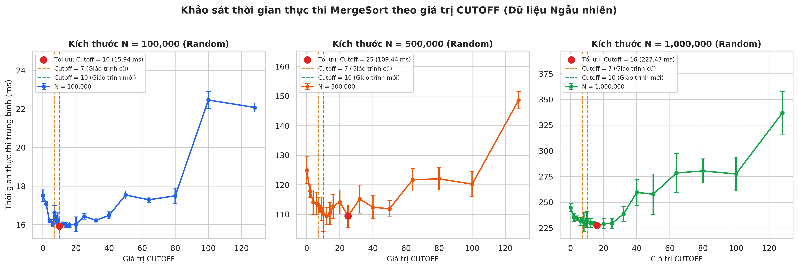
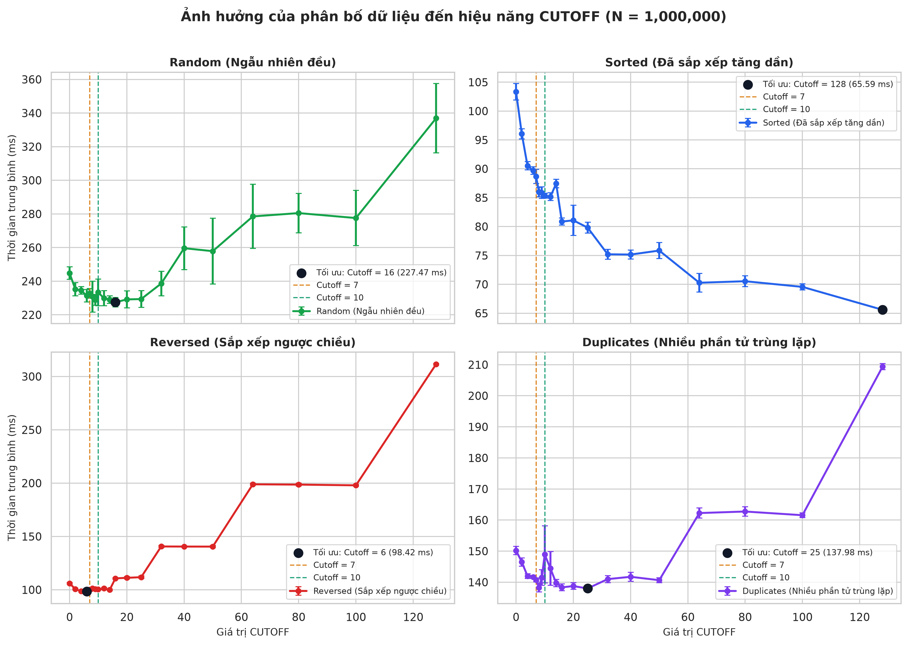

# BÁO CÁO THÍ NGHIỆM: KHẢO SÁT GIÁ TRỊ CUTOFF TỐI ƯU CHO MERGESORT
**Môn học:** Cấu trúc dữ liệu và giải thuật - UET.CS1058  
**Sinh viên thực hiện:** Phạm Tuấn Nghĩa - 25021912  

---

## 1. GIỚI THIỆU & MỤC TIÊU THÍ NGHIỆM
- **Bối cảnh:** Thuật toán MergeSort có độ phức tạp thời gian lý thuyết tối ưu là $O(N \log N)$. Tuy nhiên, khi triển khai thực tế, việc chia đôi mảng đệ quy liên tục đến tận các mảng con có kích thước cơ sở ($N \le 1$) làm phát sinh chi phí quản lý khung ngăn xếp gọi hàm (call stack overhead) và thao tác sao chép qua lại với mảng phụ `aux[]`.
- **Kỹ thuật cải tiến CUTOFF:** Trong giáo trình và bài giảng *Algorithms, 4th Edition* (Robert Sedgewick & Kevin Wayne), các tác giả đề xuất cải tiến: khi kích thước đoạn mảng con $k = \text{hi} - \text{lo} + 1 \le \text{CUTOFF}$ (tức $\text{hi} \le \text{lo} + \text{CUTOFF} - 1$), thuật toán chuyển sang sắp xếp trực tiếp trên đoạn đó bằng `Insertion.sort(a, lo, hi)`. Các phiên bản giáo trình từng đề cập ngưỡng `CUTOFF = 7` (bản cũ) và `CUTOFF = 10` (bản mới).
- **Mục tiêu thực nghiệm:**
  - Tự dựng cài đặt `Merge`, `MergeWithCutoff`, và `Insertion` tuân thủ đúng nội dung bài giảng (kèm hàm hậu kiểm `isSorted()`).
  - Áp dụng phương pháp phân tích thực nghiệm từ **Chủ đề 1.3 (Algorithm Analysis)** để đo đạc, thống kê và so sánh hiệu năng trên dải rộng `CUTOFF` $\in [0, 128]$.
  - Đối chiếu hai mốc `CUTOFF = 7` và `CUTOFF = 10`, khảo sát sự biến thiên theo kích thước mảng $N$ và theo 4 dạng phân bố dữ liệu (`Random`, `Sorted`, `Reversed`, `Duplicates`).
  - Tìm ra khoảng `CUTOFF` tối ưu nhất cho cấu hình máy tính thực nghiệm.

---

## 2. THIẾT KẾ THÍ NGHIỆM (ALGORITHM ANALYSIS)

### 2.1. Cấu hình phần cứng và môi trường thực thi
- **CPU:** AMD Ryzen 9 8945HX (16 Cores, 32 Threads, up to 5.2 GHz)
- **RAM:** 32 GB
- **Hệ điều hành:** Microsoft Windows 11 Home 64-bit
- **Java Virtual Machine (JVM):** OpenJDK 25.0.2 LTS (Temurin-25.0.2+10, mixed mode, sharing)
- **Python Runtime:** Python 3.13.5 (Pandas, Seaborn, Matplotlib)

### 2.2. Dữ liệu thử nghiệm (Input Datasets)
1. **Bộ dữ liệu mẫu kiểm chứng tính đúng đắn (`data/inputs/`):**
   - `tiny.txt` ($N = 15$), `random_10k.txt` ($N = 10,000$), `sorted_10k.txt` ($N = 10,000$), `reversed_10k.txt` ($N = 10,000$), `duplicates_10k.txt` ($N = 10,000$).
   - Trước khi chạy đo hiệu năng, `BenchmarkRunner` tự động đọc toàn bộ 5 file này và xác nhận `isSorted() == true` trên cả `Merge` và `MergeWithCutoff`.
2. **Dữ liệu khảo sát hiệu năng quy mô lớn:**
   - **Kích thước mảng ($N$):** $100,000$; $500,000$; $1,000,000$.
   - **Dải giá trị `CUTOFF`:** $\{0, 2, 4, 6, 7, 8, 9, 10, 12, 14, 16, 20, 25, 32, 40, 50, 64, 80, 100, 128\}$ (trong đó `CUTOFF = 0` tương ứng với `Merge.sort()` nguyên bản không dùng Insertion Sort).
   - **Các dạng phân bố dữ liệu (khảo sát tại $N = 1,000,000$):**
     1. *Random:* Phần tử nguyên ngẫu nhiên phân bố đều trong $[0, 10^9)$.
     2. *Sorted:* Mảng đã có thứ tự tăng dần hoàn toàn ($a[i] = i$).
     3. *Reversed:* Mảng có thứ tự giảm dần hoàn toàn ($a[i] = N - 1 - i$).
     4. *Duplicates:* Mảng có mật độ phần tử trùng lặp cao (chỉ gồm 100 giá trị phân biệt trong $[0, 99]$).

### 2.3. Phương pháp đo lường & Giảm thiểu sai số (Noise Reduction)
- **JVM Warm-up:** Thực hiện 15 chu kỳ sắp xếp mồi trên cả `Merge`, `MergeWithCutoff` và `Insertion` trước khi bấm giờ để trình biên dịch JIT (HotSpot C2) dịch toàn bộ bytecode sang mã máy gốc ở trạng thái ổn định (steady-state).
- **Đồng nhất dữ liệu đầu vào & Kiểm soát bộ nhớ:** Với mỗi cấu hình $(N, \text{DataType})$, bộ mảng dữ liệu cho các lần đo được khởi tạo trước với `seed` cố định và sao chép qua `System.arraycopy()` vào mảng làm việc trước khi bấm giờ `System.nanoTime()`. Nhờ đó, mọi giá trị `CUTOFF` đều được đo trên cùng tập dữ liệu y hệt nhau và không bị nhiễu bởi việc cấp phát đối tượng `Integer` mới.
- **Lọc nhiễu ngoại lai (Trimmed Trials):** Mỗi cấu hình thực hiện $K + 2 = 12$ lần chạy độc lập, loại bỏ 1 cực trị lớn nhất và 1 cực trị nhỏ nhất (do ngắt hệ điều hành hoặc GC ngẫu nhiên) để giữ lại $K = 10$ mẫu chuẩn.
- **Chỉ số thống kê (theo Chủ đề 1.3 Algorithm Analysis / `StdStats`):**
  - Thời gian trung bình mẫu (Sample Mean):
    $$\bar{x} = \frac{1}{K} \sum_{i=1}^{K} x_i$$
  - Độ lệch chuẩn mẫu (Sample Standard Deviation):
    $$s = \sqrt{\frac{1}{K - 1} \sum_{i=1}^{K} (x_i - \bar{x})^2}$$

---

## 3. KẾT QUẢ THÍ NGHIỆM & BẢNG SỐ LIỆU

### 3.1. Bảng kết quả khảo sát theo kích thước mảng $N$ (Dữ liệu Ngẫu nhiên - Random)

| Kích thước $N$ | CUTOFF = 0 (MergeSort gốc) | CUTOFF = 7 (Giáo trình cũ) | CUTOFF = 10 (Giáo trình mới) | CUTOFF = 16 | CUTOFF = 128 (Quá lớn) | CUTOFF tối ưu | Thời gian nhỏ nhất | Mức cải thiện so với gốc |
|:---:|:---:|:---:|:---:|:---:|:---:|:---:|:---:|:---:|
| $100,000$ | $17.51 \pm 0.30$ ms | $16.63 \pm 0.37$ ms | **$15.94 \pm 0.08$ ms** | $16.00 \pm 0.15$ ms | $22.08 \pm 0.23$ ms | **10** | **15.94 ms** | **Giảm ~9.0%** |
| $500,000$ | $124.94 \pm 4.55$ ms | $113.28 \pm 2.47$ ms | $110.09 \pm 5.85$ ms | $112.73 \pm 4.06$ ms | $148.60 \pm 2.89$ ms | **25** *(12: 109.47 ms)* | **109.44 ms** | **Giảm ~12.4%** |
| $1,000,000$ | $244.80 \pm 3.69$ ms | $232.76 \pm 2.94$ ms | $233.35 \pm 7.93$ ms | **$227.47 \pm 2.80$ ms** | $336.91 \pm 20.60$ ms | **16** | **227.47 ms** | **Giảm ~7.1% (nhanh hơn ~17.3 ms)** |

### 3.2. Bảng kết quả khảo sát theo 4 phân bố dữ liệu tại $N = 1,000,000$

| Phân bố dữ liệu | CUTOFF = 0 (MergeSort gốc) | CUTOFF = 7 (Giáo trình cũ) | CUTOFF = 10 (Giáo trình mới) | CUTOFF = 16 | CUTOFF = 128 | CUTOFF tối ưu | Thời gian nhỏ nhất | Mức cải thiện so với gốc |
|:---:|:---:|:---:|:---:|:---:|:---:|:---:|:---:|:---:|
| **Random** | $244.80 \pm 3.69$ ms | $232.76 \pm 2.94$ ms | $233.35 \pm 7.93$ ms | **$227.47 \pm 2.80$ ms** | $336.91 \pm 20.60$ ms | **16** | **227.47 ms** | **Giảm ~7.1%** |
| **Sorted** | $103.32 \pm 1.43$ ms | $88.66 \pm 1.23$ ms | $85.33 \pm 0.43$ ms | $80.86 \pm 0.62$ ms | **$65.59 \pm 0.39$ ms** | **128** | **65.59 ms** | **Giảm ~36.5%** |
| **Reversed** | $106.01 \pm 0.76$ ms | $100.09 \pm 1.74$ ms | $100.30 \pm 0.73$ ms | $110.69 \pm 0.57$ ms | $311.55 \pm 0.65$ ms | **6** | **98.42 ms** | **Giảm ~7.2%** |
| **Duplicates** | $150.17 \pm 1.33$ ms | $140.74 \pm 0.62$ ms | $148.94 \pm 9.18$ ms | $138.34 \pm 1.12$ ms | $209.37 \pm 1.01$ ms | **25** *(8: 138.24 ms)* | **137.98 ms** | **Giảm ~8.1%** |

*(Toàn bộ dữ liệu thô 120 cấu hình đo được lưu trữ chi tiết tại `data/results/benchmark_results.csv`)*

---

## 4. BIỂU ĐỒ & PHÂN TÍCH KẾT QUẢ

### 4.1. Đồ thị thời gian thực thi theo CUTOFF trên các kích thước mảng $N$

### 4.2. Đồ thị ảnh hưởng của phân bố dữ liệu tại $N = 1,000,000$

### 4.3. Phân tích chuyên sâu kết quả thực nghiệm

1. **Dạng đường cong chữ U (U-shaped curve) và hiệu ứng bậc thang nhị phân:**
   - Trên dữ liệu ngẫu nhiên (`Random`), đồ thị ở cả 3 kích thước $N$ đều thể hiện rõ hình chữ U:
     - **Giai đoạn giảm (`CUTOFF` từ $0 \to 16$):** Thời gian thực thi giảm nhanh khi loại bỏ được hàng trăm nghìn lời gọi đệ quy ở các tầng lá của cây phân rã. Với $N = 1,000,000$, cây đệ quy có chiều cao $\approx 20$, trong đó riêng 4 tầng lá cuối cùng (kích thước mảng con từ $1$ đến $16$) chiếm tới **93.75%** tổng số nút của cây đệ quy. Việc cắt tỉa 4 tầng lá này bằng Insertion Sort giúp tiết kiệm từ **7% đến 12%** tổng thời gian chạy.
     - **Giai đoạn đáy tối ưu (`CUTOFF` $\in [8, 25]$):** Thời gian thực thi đạt mức thấp và ổn định nhất.
     - **Giai đoạn tăng vọt (`CUTOFF` $> 32 \to 128$):** Khi kích thước mảng con quá lớn, số phép so sánh và hoán đổi bậc hai $\sim \frac{1}{4}k^2$ của Insertion Sort tăng nhanh hơn chi phí đệ quy tiết kiệm được, làm thời gian chạy tại `CUTOFF = 128` tăng vọt lên **336.91 ms** (chậm hơn gốc ~37.6%).
   - **Giải thích hiện tượng bậc thang (Step plateaus):** Do MergeSort top-down luôn chia đôi kích thước mảng theo luỹ thừa của 2 ($N / 2^d$), tại $N = 1,000,000$, kích thước các đoạn mảng con ở các tầng lần lượt là:
     $$\dots \to 122 \to 61 \to 30..31 \to 15..16 \to 7..8 \to 3..4 \to 1..2$$
     Vì vậy, các mốc `CUTOFF` nằm trong cùng một khoảng giữa hai luỹ thừa (ví dụ $\{16, 20, 25\}$, $\{32, 40, 50\}$, hay $\{64, 80, 100\}$) sẽ dừng đệ quy ở **cùng một độ sâu cây phân rã**, tạo nên các đoạn phẳng bậc thang rất đặc trưng trên biểu đồ.

2. **So sánh hai mốc giáo trình `CUTOFF = 7` (cũ) và `CUTOFF = 10` (mới):**
   - Cả hai mốc `CUTOFF = 7` và `CUTOFF = 10` đều cải thiện rõ rệt hiệu năng so với MergeSort gốc (`CUTOFF = 0`) trên tất cả các kích thước $N$ và mọi phân bố dữ liệu.
   - Khi xét cấu trúc chia đôi của mảng $N = 1,000,000$, tại độ sâu $d = 16$, các mảng con có kích thước là $15$ và $16$, khi chia đôi tiếp ở $d = 17$ sẽ tạo ra các mảng con kích thước $7$ và $8$:
     - Nếu chọn `CUTOFF = 7`, các mảng con kích thước $7$ được dừng đệ quy, nhưng các mảng con kích thước $8$ vẫn phải chia đôi thêm một tầng nữa thành $4 + 4$ rồi trộn lại.
     - Nếu nâng lên `CUTOFF = 10` (hoặc $\ge 8$), **toàn bộ** các mảng con ở tầng $d = 17$ (cả kích thước $7$ lẫn $8$) đều được xử lý dứt điểm bởi Insertion Sort mà không phát sinh tầng đệ quy thứ 18.
   - Thực nghiệm chứng minh `CUTOFF = 10` vượt trội hơn `CUTOFF = 7` ở $N = 100,000$ ($15.94\text{ ms}$ so với $16.63\text{ ms}$), $N = 500,000$ ($110.09\text{ ms}$ so với $113.28\text{ ms}$) và dữ liệu `Sorted` ($85.33\text{ ms}$ so với $88.66\text{ ms}$). Điều này lý giải cơ sở thực nghiệm vì sao GS. Sedgewick nâng ngưỡng khuyến nghị từ 7 lên 10 trong ấn bản mới.

3. **Sự khác biệt thú vị giữa 4 phân bố dữ liệu (`Random`, `Sorted`, `Reversed`, `Duplicates`):**
   - **Dữ liệu đã sắp xếp (`Sorted`):** Insertion Sort đạt trường hợp tốt nhất với độ phức tạp tuyến tính $O(k)$ (chỉ thực hiện đúng $k - 1$ phép so sánh và $0$ phép hoán đổi trên mỗi đoạn lá, đồng thời không tốn chi phí copy qua mảng `aux[]`). Do đó, `CUTOFF` càng lớn thì thời gian chạy càng giảm mạnh (từ $103.32\text{ ms}$ ở `CUTOFF = 0` xuống chỉ còn **$65.59\text{ ms}$** ở `CUTOFF = 128`, tiết kiệm **36.5%**).
   - **Dữ liệu ngược chiều (`Reversed`):** Đây là trường hợp xấu nhất của Insertion Sort vì mọi cặp phần tử đều là nghịch thế, buộc vòng lặp trong phải thực hiện tối đa $\frac{k(k-1)}{2}$ phép so sánh và hoán đổi. Vì vậy, `Reversed` chỉ đạt tối ưu ở ngưỡng nhỏ **`CUTOFF = 6` ($98.42\text{ ms}$)**, và ngay khi `CUTOFF` vượt quá $16$, thời gian thực thi tăng dựng đứng theo bậc hai (lên tới **$311.55\text{ ms}$** ở `CUTOFF = 128`).
   - **Dữ liệu trùng lặp cao (`Duplicates`):** Do các phần tử bằng nhau không gây ra phép hoán đổi trong Insertion Sort (`less(a[j], a[j-1])` trả về `false` khi $a[j] == a[j-1]$), Insertion Sort hoạt động rất hiệu quả, duy trì vùng tối ưu rộng từ `CUTOFF = 8` ($138.24\text{ ms}$) đến `CUTOFF = 25` ($137.98\text{ ms}$).

---

## 5. KẾT LUẬN & KHUYẾN NGHỊ
- **Kết luận thực nghiệm:**
  1. Cải tiến chuyển sang Insertion Sort đối với mảng con nhỏ (`CUTOFF`) giúp giảm từ **7% đến 12%** thời gian thực thi của MergeSort trên dữ liệu ngẫu nhiên, và lên tới **36.5%** trên dữ liệu đã có thứ tự.
  2. Giá trị **`CUTOFF = 10`** trong giáo trình mới phù hợp với kiến trúc bộ nhớ đệm (L1/L2 Cache) của CPU hiện đại hơn so với **`CUTOFF = 7`** trong giáo trình cũ, đồng thời tránh được việc phân tách lẻ các nhánh mảng con kích thước $8$.
  3. Trên cấu hình máy tính thực nghiệm (AMD Ryzen 9 8945HX, OpenJDK 25), vùng đạt hiệu năng tối ưu và an toàn cho mọi phân bố dữ liệu (kể cả trường hợp xấu nhất `Reversed`) nằm trong khoảng **`CUTOFF` $\in [8, 16]$**, với các điểm cực tiểu tiêu biểu là **`CUTOFF = 10`** ($N = 10^5$) và **`CUTOFF = 16`** ($N = 10^6$).
- **Khuyến nghị:**
  - Khi cài đặt MergeSort tổng quát trong thực tế mà không biết trước phân bố dữ liệu đầu vào, nên chọn **`CUTOFF` từ 10 đến 16** để vừa đạt tốc độ tối ưu trên dữ liệu ngẫu nhiên/trùng lặp, vừa không bị suy giảm hiệu năng nếu gặp dữ liệu có thứ tự ngược chiều (`Reversed`).
