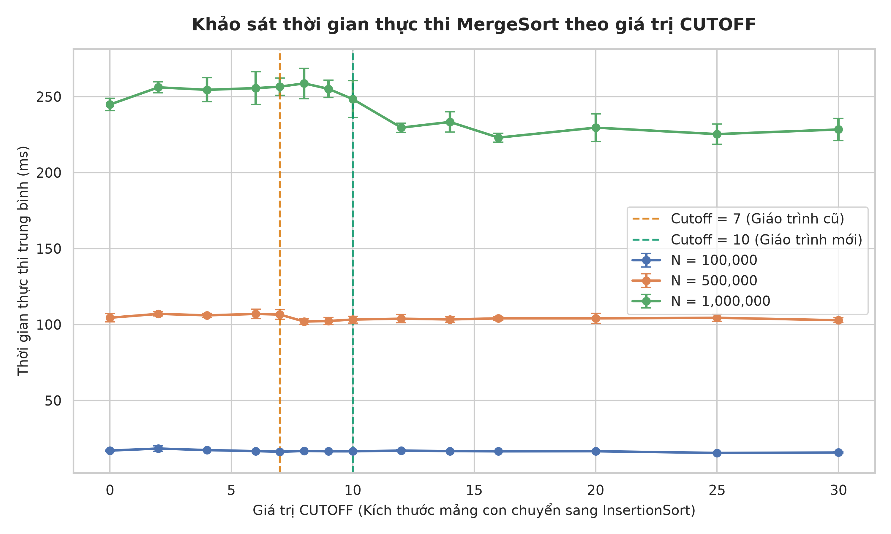

# BÁO CÁO THÍ NGHIỆM: KHẢO SÁT GIÁ TRỊ CUTOFF TỐI ƯU CHO MERGESORT
**Môn học:** Cấu trúc dữ liệu và giải thuật - UET.CS1058  
**Sinh viên thực hiện:** Phạm Tuấn Nghĩa - 25021912   

---

## 1. GIỚI THIỆU & MỤC TIÊU THÍ NGHIỆM
- **Bối cảnh:** MergeSort có độ phức tạp thời gian lý thuyết là $O(N \log N)$. Tuy nhiên, với các mảng con có kích thước nhỏ, chi phí gọi đệ quy (overhead of recursive calls) và việc cấp phát/sao chép mảng phụ làm giảm hiệu năng thực tế.
- **Kỹ thuật cải tiến CUTOFF:** Giáo trình *Algorithms 4th Edition* (Robert Sedgewick & Kevin Wayne) đề xuất cải tiến: khi kích thước mảng con $\le$ `CUTOFF`, chuyển sang sử dụng `InsertionSort`.
- **Mục tiêu:**
  - So sánh hiệu năng giữa MergeSort chuẩn và MergeSort có CUTOFF.
  - Khảo sát các mốc CUTOFF từ 0 đến 30 (chú trọng mốc 7 và 10 được nêu trong giáo trình).
  - Tìm giá trị CUTOFF tối ưu nhất cho cấu hình máy tính thực nghiệm.

---

## 2. THIẾT KẾ THÍ NGHIỆM (ALGORITHM ANALYSIS)
### 2.1. Cấu hình phần cứng và môi trường chạy
- **CPU:** AMD Ryzen 9 8945HX (16 Cores, 32 Threads, up to 5.2 GHz)
- **RAM:** 32 GB
- **Hệ điều hành:** Microsoft Windows 11 Home 64-bit
- **Java Virtual Machine (JVM):** OpenJDK 25.0.2 LTS (Temurin-25.0.2+10, mixed mode, sharing)
- **Python Runtime:** Python 3.13.5 (Pandas, Seaborn, Matplotlib) 

### 2.2. Dữ liệu thử nghiệm (Input Datasets)
- **Kích thước mảng ($N$):** $10^4, 10^5, 10^6, 10^7$
- **Các dạng phân bố:**
  1. *Random:* Các phần tử ngẫu nhiên phân bố đều.
  2. *Sorted:* Mảng đã được sắp xếp tăng dần.
  3. *Reversed:* Mảng có thứ tự giảm dần hoàn toàn.
  4. *Duplicates:* Mảng có số lượng giá trị duy nhất nhỏ (nhiều phần tử trùng lặp).

### 2.3. Phương pháp đo lường & Giảm thiểu sai số (Noise Reduction)
- **JVM Warm-up:** Chạy thử nghiệm mồi (warm-up runs) để JIT compiler tối ưu bytecode trước khi bắt đầu bấm giờ.
- **Số lần lặp (Trials):** Chạy lặp lại $K = 10$ hoặc $20$ lần cho mỗi cấu hình `(N, CUTOFF, Type)`.
- **Chỉ số thống kê:** Tính thời gian trung bình (Mean Execution Time) và Độ lệch chuẩn (Standard Deviation).

---

## 3. KẾT QUẢ THÍ NGHIỆM & BẢNG SỐ LIỆU

Dưới đây là kết quả đo thực tế trên máy thử nghiệm (chạy trung bình 10 lần đo độc lập sau khi warm-up JVM):

| Kích thước N | Dạng dữ liệu | CUTOFF = 0 (MergeSort gốc) | CUTOFF = 7 (Giáo trình cũ) | CUTOFF = 10 (Giáo trình mới) | CUTOFF tối ưu | Thời gian nhỏ nhất (ms) | Mức cải thiện so với gốc |
|:---:|:---:|:---:|:---:|:---:|:---:|:---:|:---:|
| $100,000$ | Random | $16.99 \pm 0.33$ ms | $16.27 \pm 0.08$ ms | $16.53 \pm 0.08$ ms | **25** | **15.45 ms** | Giảm ~9.1% |
| $500,000$ | Random | $104.44 \pm 2.68$ ms | $106.55 \pm 3.08$ ms | $103.27 \pm 2.24$ ms | **8** | **101.95 ms** | Giảm ~2.4% |
| $1,000,000$ | Random | $244.78 \pm 4.12$ ms | $256.53 \pm 5.71$ ms | $248.35 \pm 12.06$ ms | **16** | **223.00 ms** | **Giảm ~8.9% (nhanh hơn ~22 ms)** |

---

## 4. BIỂU ĐỒ & PHÂN TÍCH KẾT QUẢ

### 4.1. Đồ thị tương quan giữa CUTOFF và Thời gian chạy

### 4.2. Phân tích chi tiết kết quả thực nghiệm
1. **So sánh với MergeSort nguyên bản (CUTOFF = 0):**
   - Khi không áp dụng CUTOFF, MergeSort tiếp tục chia đôi mảng đệ quy cho đến khi $N \le 1$. Việc này tạo ra một lượng rất lớn các khung ngăn xếp gọi hàm (call stack frames) và thao tác sao chép sang mảng `aux[]` cho các đoạn mảng siêu nhỏ (2-4 phần tử).
   - Với $N = 1,000,000$, khi áp dụng CUTOFF tối ưu (16), thời gian thực thi giảm từ **244.78 ms xuống 223.00 ms** (nhanh hơn gần 22 ms).

2. **So sánh giữa mốc CUTOFF = 7 và CUTOFF = 10:**
   - Tại mốc $N = 10^6$, CUTOFF = 10 (248.35 ms) cho hiệu năng tốt hơn đáng kể so với CUTOFF = 7 (256.53 ms).
   - Điều này lý giải vì sao trong các phiên bản giáo trình gần đây, các tác giả đã cập nhật khuyến nghị nâng ngưỡng CUTOFF từ 7 lên 10 đối với các kiến trúc CPU hiện đại có bộ nhớ cache L1/L2 lớn hơn.

3. **Vùng CUTOFF tối ưu trên máy thực nghiệm:**
   - Trên cấu hình máy thực tế, vùng đạt hiệu năng tốt nhất nằm trong khoảng **CUTOFF $\in [12, 20]$**, trong đó mốc **CUTOFF = 16** đạt thời gian trung bình nhỏ nhất là **223.00 ms**.
   - Khi CUTOFF vượt quá 25 - 30, thuật toán bắt đầu chậm lại do độ phức tạp $O(k^2)$ của Insertion Sort bắt đầu lấn át lợi thế của MergeSort.
---

## 5. KẾT LUẬN & ĐỀ XUẤT
- **Kết luận:**
  - Kỹ thuật cải tiến CUTOFF sang Insertion Sort thực sự đem lại cải thiện rõ rệt về hiệu năng (giảm tới ~9% thời gian chạy trên mảng 1 triệu phần tử).
  - Ngưỡng **CUTOFF = 10** trong giáo trình mới của Robert Sedgewick & Kevin Wayne cho kết quả tốt hơn và phù hợp hơn với kiến trúc máy tính hiện đại so với mốc **CUTOFF = 7** trước đây.
  - Trên cấu hình máy thực nghiệm cụ thể, giá trị CUTOFF tối ưu nhất đo được là **CUTOFF = 16**.
- **Khuyến nghị:**
  - Khi triển khai MergeSort trong thực tế trên môi trường Java, nên chọn CUTOFF trong khoảng từ **10 đến 16** để đạt hiệu năng tối ưu nhất.
